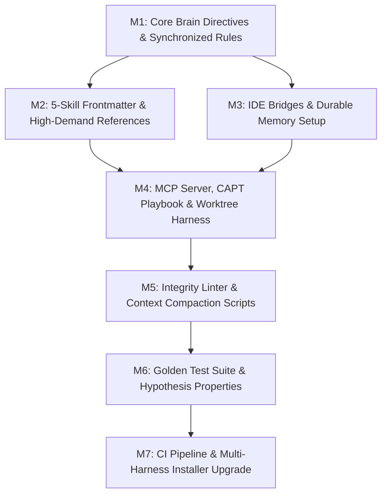

# Active Agent Milestone DAG Plan (`PLAN.md`)

## Milestone Breakdown & Kahn's Topological Order

1. **`M1` [Done]**: Synchronize `AGENTS.md`, `GEMINI.md`, `CLAUDE.md` with 7-tuple $\theta$, 10 macros, MathJax fenced blocks, and `RULE-01`..`RULE-07`.
2. **`M2` [Done]**: Expand `skills/agentic-orchestration/` and add 2026 high-demand references across all 5 skills.
3. **`M3` [Done]**: Create Cursor MDC `.cursor/rules/expert-architect.mdc`, GitHub `.github/copilot-instructions.md`, and memory state files.
4. **`M4` [Done]**: Implement `templates/mcp-server-fastapi/server.py`, `templates/playbooks/incident_and_architecture_audit.j2.md`, `templates/hooks/maker_checker_loop.sh`, and `templates/kubernetes/keda-cilium-policy.yaml`.
5. **`M5` [Done]**: Implement `scripts/validate_repo_integrity.py` and `scripts/context_compactor.py`.
6. **`M6` [Done]**: Build `tests/test_integrity.py`, `tests/test_fastapi_pytorch.py`, `tests/test_mcp_server.py`.
7. **`M7` [Done]**: Finalize `install.sh`, `README.md`, `.github/workflows/ci-verify.yml`, and `.github/PULL_REQUEST_TEMPLATE.md`.
