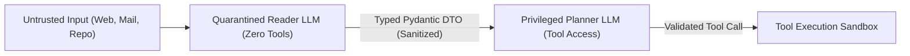

# Agentic LLM Threat Modeling, Supply-Chain SLSA Level 3 & Sigstore Cosign

Authoritative engineering manual on defending against Indirect Prompt Injection, confused deputy vulnerabilities in Model Context Protocol (MCP) agents, SLSA Level 3 provenance, and Sigstore Cosign keyless signing.

---

## 1. Dual-LLM Quarantine Architecture

When autonomous agents consume untrusted external content (web pages, repositories, emails, tool outputs), single-LLM architectures are susceptible to **Indirect Prompt Injection** that hijacks tool calls.



- **Quarantined Reader LLM**: Has zero tool-call capability. Its prompt instructs it exclusively to parse, extract, and populate a strict Pydantic model.
- **Privileged Planner LLM**: Holds tool definitions and operational secrets, but NEVER directly views raw untrusted strings.

---

## 2. MCP Path Traversal & SSRF Defense

```python
from __future__ import annotations
import ipaddress
import socket
from pathlib import Path
from urllib.parse import urlparse

WORKSPACE_ROOT = Path("/workspace").resolve()

def sanitize_file_path(target_path_str: str) -> Path:
    target = (WORKSPACE_ROOT / target_path_str).resolve()
    if not target.is_relative_to(WORKSPACE_ROOT):
        raise PermissionError(f"Access denied: {target_path_str} traverses outside workspace root")
    return target

def validate_outbound_url(url: str) -> str:
    parsed = urlparse(url)
    if parsed.scheme not in ("http", "https"):
        raise ValueError(f"Disallowed scheme: {parsed.scheme}")
    hostname = parsed.hostname or ""
    ip_addr = socket.gethostbyname(hostname)
    ip = ipaddress.ip_address(ip_addr)
    if ip.is_private or ip.is_loopback or ip.is_link_local or ip == ipaddress.ip_address("169.254.169.254"):
        raise PermissionError(f"SSRF blocked: Attempted request to private IP {ip_addr}")
    return url
```

---

## 3. SLSA Level 3 & Sigstore Cosign Container Attestation

- **Dependency Pinning**: All Python dependencies must be hash-pinned via `requirements.txt --require-hashes` or `uv.lock`.
- **SBOM Generation**: Generate CycloneDX JSON Software Bill of Materials during container build.
- **Keyless Image Signing**:
  ```bash
  cosign sign --yes "${IMAGE_DIGEST}"
  cosign attest --yes --predicate sbom.cyclonedx.json --type cyclonedx "${IMAGE_DIGEST}"
  ```

---

## 4. OWASP LLM01:2025 Deep Defense & Dual-LLM Guardrail Protocol

### 4.1 Quarantined vs. Privileged Functional Isolation
- **Quarantined Reader**: Consumes raw untrusted inputs (PDFs, scraped web HTML, emails, external tool outputs). Possesses zero tools, zero database connections, and zero shell execution privileges. Produces strictly typed, inert JSON data models.
- **Privileged Planner**: Operates business logic and dispatches tools. Never processes raw, unsanitized external strings directly.
- **Structural Boundaries**: Wrap untrusted text blocks in explicit XML tags (`<untrusted_payload>...</untrusted_payload>`) with parser directives enforcing data-only treatment.

### 4.2 Tool Allowlisting, ABAC & Canary Tripwires
- **Server-Side Allowlisting**: Backend tool registries must strictly validate incoming tool execution calls against user session RBAC/ABAC tokens—never trust the agent's self-reported permissions.
- **Canary Tokens**: Embed unique canary strings inside system prompts; automated egress tripwires trigger immediate alerts and session severance if a canary token appears in outbound payloads.

